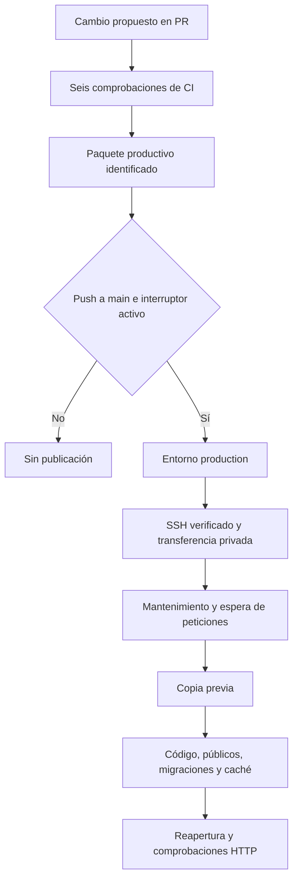

# Configuración y preparación del despliegue de Aselto

Material para la memoria y la defensa del TFM. Fecha de recopilación: **18 de noviembre de 2026**.

Este capítulo explica el propósito de la configuración realizada y su relación con el funcionamiento de Aselto. Las instrucciones de ejecución y los valores operativos se mantienen en la [guía de GitHub–Hostinger](github-hostinger.md). La instalación inicial y sus incidencias se documentan en [Hostinger para el TFM](hostinger-tfm.md).

**Estado actualizado:** primera publicación desde GitHub Actions completada el 18/11/2026, [ejecución 44397469824](https://github.com/DaniCorreaPlaceres/TFM-Aselto/actions/runs/44397469824), commit main 3633342. Comprobaciones, paquete y job SSH correctos; copia privada creada, migraciones al día y esquema sincronizado. Consulta HTTP posterior confirma inicio/salud/acceso 200, API anónima 401, archivos internos 404 y versión junto al copyright. HOSTINGER_DEPLOY_ENABLED permanece true por autorización del usuario. La versión sigue siendo 1.0.0-dev, sin etiqueta final. Las explicaciones de preparación que siguen son históricas: su primer CD ya se ha realizado. La purga manual de caché no está confirmada ni se demuestra una invalidación general de OPcache. [Evidencia y límites](../sdd/hostinger-deployment-investigation.md).

## 1. Objetivo del trabajo

El despliegue convierte el código del proyecto en un servicio accesible desde Internet. Además de copiar archivos, requiere preparar el intérprete PHP, las dependencias, los recursos visuales, la base de datos y los servicios auxiliares. También debe proteger la información privada y permitir detectar y recuperar fallos.

En Aselto se ha seguido una secuencia de dos fases. Primero se realizó una instalación manual guiada para comprobar las condiciones reales de Hostinger y corregir las incidencias encontradas. Después se preparó la automatización de los pasos ya ensayados. De esta forma, las instrucciones del CI/CD se basan en una instalación que ha funcionado en el destino, con sus límites documentados.

La preparación de Hostinger, tarea 45, se cerró con aceptación del usuario y pendientes trasladados a la revisión final. Ese cierre no convierte las comprobaciones aplazadas en pruebas realizadas. La automatización corresponde a la tarea 46 y todavía requiere su primera ejecución real.

## 2. Desarrollo y alojamiento de destino

El desarrollo local utiliza Docker para disponer de servicios reproducibles. La aplicación se aloja en producción en Hostinger Cloud Startup, con acceso SSH. No se presupone que el alojamiento ejecute el mismo Docker de desarrollo ni que permita mantener cualquier proceso permanente.

PHP ejecuta el código de Symfony. Composer instala las bibliotecas de las que depende el proyecto, y MariaDB conserva los datos persistentes. El navegador recibe HTML, estilos, JavaScript, imágenes y respuestas de la API a través de HTTPS.

Esta separación permite preparar recursos y dependencias fuera del hosting y transferir un paquete listo para instalar. El servidor no necesita recibir herramientas de desarrollo, pruebas o credenciales del equipo local para ejecutar la aplicación.

### PHP web y PHP de consola

El PHP utilizado para atender una página puede ser distinto del que ejecuta un comando SSH. En la primera revisión, la consola utilizaba una versión anterior a la requerida por Aselto. Por eso se identificó y probó el binario `/opt/alt/php84/usr/bin/php`, que devuelve PHP 8.4.27.

Usar su ruta absoluta en consola y cron evita que un cambio en el PHP predeterminado ejecute migraciones o tareas con una versión incompatible. Composer también se invocó con ese mismo PHP y confirmó los requisitos productivos, incluida sodium, necesaria para las dependencias de autenticación.

Los requisitos comprobados por consola no prueban todos los parámetros efectivos del PHP web. Esta diferencia se mantiene explícita en las evidencias.

### Motor de base de datos

El entorno local y la CI conservan MySQL 8.4 como referencia. El alojamiento comunica MariaDB 11.8.9. Antes de la instalación se ensayó la compatibilidad en una MariaDB desechable; después se aplicaron en Hostinger las 19 migraciones y Doctrine confirmó el esquema sincronizado.

El parámetro `serverVersion` de `DATABASE_URL` identifica el motor del destino para que Doctrine utilice su plataforma correspondiente. No debe indicar MySQL 8.4 cuando la conexión real es MariaDB. La compatibilidad observada no implica que todas las opciones o capacidades de ambos motores sean idénticas.

## 3. Separación entre archivos públicos y privados

La raíz web `public_html` contiene únicamente el punto de entrada de Symfony y los recursos que puede recibir un navegador. El código y la información privada se conservan en `private/aselto`, fuera de esa raíz.

```text
Directorio del dominio/
├── public_html/                 Recursos accesibles por HTTP
│   ├── index.php                Entrada a Symfony
│   ├── .htaccess                Reglas de LiteSpeed y cabeceras
│   ├── assets/                  Recursos compilados
│   └── vendor/                  Bibliotecas públicas del navegador
└── private/
    ├── aselto/                  Aplicación y dependencias PHP
    │   ├── .env.local           Configuración privada
    │   ├── config/jwt/          Claves de autenticación API
    │   └── var/                 Documentos y estado persistente
    ├── incoming/                Paquetes recibidos por SSH
    └── backups/                 Copias privadas de recuperación
```

La carpeta `vendor` pública contiene bibliotecas del navegador, como PDF.js; no es la carpeta de dependencias PHP de Composer, que permanece en la aplicación privada.

`index.php` dirige la petición hacia Symfony cargando la aplicación privada. Su ruta se adaptó a esta disposición. `.htaccess` configura el enrutamiento hacia ese punto de entrada, bloquea determinados accesos directos y establece cabeceras. Por ello, una portada visible no basta para comprobar que funcionan todas las rutas.

### Permisos de lectura y escritura

Se utilizaron permisos 0700 para carpetas privadas y 0600 para configuración, claves y archivos privados revisados. En términos prácticos, permiten acceso al propietario sin abrirlo a otros usuarios Unix. Los recursos públicos necesitan permisos de lectura para el servidor; el `.htaccess` público utiliza 0644.

Los permisos deben ajustarse al destino del archivo. Durante una recuperación, copiar `.htaccess` preservando el permiso 0600 del backup dejó de aplicar correctamente el enrutamiento; al devolverlo a 0644 se recuperó el servicio. La copia privada conservó su restricción.

Esta protección no aísla procesos que compartan el mismo usuario Unix ni sustituye los permisos de negocio de Symfony. El control de archivos del servidor y el aislamiento entre clientes son capas distintas.

## 4. Configuración privada de la aplicación

`.env.local` contiene los valores propios de la instalación. No se incorpora a Git, al paquete productivo ni al chat. La automatización conserva ese archivo al actualizar código.

Los principales valores tienen estas funciones:

- `APP_ENV=prod` selecciona la configuración de producción. `APP_DEBUG=0` evita habilitar la depuración en la instalación pública.
- `APP_SECRET` aporta el secreto propio de Symfony. Debe generarse para la instalación y mantenerse privado.
- `DATABASE_URL` identifica servidor, usuario, contraseña, base, motor y codificación. Los caracteres reservados de las credenciales se codifican para escribirlos correctamente dentro de la URL.
- `DEFAULT_URI` fija el origen canónico HTTPS utilizado, entre otros casos, para los enlaces enviados por correo. `TRUSTED_HOSTS` limita los nombres de host aceptados por la aplicación.
- `MAILER_DSN` define cómo se conecta el transporte de correo. `MAILER_FROM` identifica el remitente de los correos de cuenta.
- `JWT_PASSPHRASE` protege la clave privada JWT. Las rutas de claves señalan los archivos privados de la instalación.
- `OPENAI_API_KEY` permite conectar al proveedor real cuando se configure. En el ensayo permanece vacía: se utiliza una propuesta de ejemplo, no extracción real.
- `SECURITY_ALERT_EMAIL_ENABLED`, `SECURITY_ALERT_RECIPIENT` y `SECURITY_ALERT_FROM` controlan la entrega de resúmenes de seguridad, su destinatario y su remitente.

Guardar un valor como secreto no garantiza por sí solo una configuración correcta. Por ello se probaron por separado arranque, conexión a la base, correo y autenticación.

## 5. Correo y activación de cuentas

El correo de Aselto se configuró con SMTP de Hostinger, puerto 465 y conexión cifrada. La cuenta remitente es `no-responder@aselto.com`. Su contraseña solo se introduce en la configuración privada del alojamiento.

SMTP permite que la aplicación entregue un mensaje al servidor de correo. Un resultado satisfactorio del transporte no garantiza que el destinatario lo haya recibido; por eso se comprobaron tanto la aceptación SMTP como la llegada a la bandeja de entrada y el uso del enlace.

Durante la preparación se usó `null://null`, que descarta los mensajes. Sirve para construir o probar sin envíos externos. La interfaz puede mostrar una confirmación genérica aunque no se entregue correo; ese mensaje también evita revelar si una cuenta existe.

Se corrigió un remitente fijo de desarrollo terminado en `.test`, sustituyéndolo por `MAILER_FROM`. Después se verificaron recepción, creación de contraseña e inicio de sesión. El superadmin inicial se creó mediante consola y activación por correo, conservando separada la cuenta cliente; no se importaron contraseñas o usuarios demo en el hosting.

### Claves JWT frente a claves SSH

Las claves JWT permiten a Aselto firmar y verificar los tokens usados por su API. Son parte de la aplicación y permanecen en Hostinger. No se regeneran en cada actualización, ya que forman parte del estado de seguridad de la instalación.

La clave SSH del CI/CD tiene otra función: permite a GitHub Actions conectarse al servidor para transferir y ejecutar la instalación. No sirve para entrar como cliente en la web ni sustituye la contraseña de una cuenta de Aselto.

## 6. Recursos visuales y límites del alojamiento

Composer instala las dependencias PHP productivas. Importmap prepara los módulos JavaScript, Sass compila los estilos y AssetMapper genera los recursos públicos identificados por su contenido. El paquete incluye los resultados compilados, evitando depender de una compilación manual en el servidor.

El visor PDF permitió detectar una diferencia importante entre desarrollo y alojamiento. Dos módulos `.mjs` respondían con estado 200, pero Hostinger los servía como `text/plain`; el navegador no los ejecutaba como JavaScript. Se configuró su tipo `application/javascript` y el de `.wasm` como `application/wasm`. La solución mantuvo CSP y `nosniff`, en vez de reducir las protecciones del navegador.

En hPanel se observaron límites de subida y cuerpo de 256M, que el usuario indicó que no podía reducir. También comunicó memoria 512M, ejecución 300 s y entrada 240 s. Aselto conserva su validación de 8 MB por archivo, probada mediante el aviso visible del formulario. Esa validación no equivale a un límite previo de recepción del servidor, y no se ha presentado como tal.

Para las cifras trimestrales se eligió actualización al recargar o pulsar Actualizar en producción. Así el despliegue no depende de un hub Mercure permanente no verificado en Cloud Startup. El modo en vivo se conserva para desarrollo.

## 7. Integración continua: qué comprueba GitHub

La integración continua, CI, ejecuta comprobaciones cuando se propone o integra un cambio. Su objetivo es detectar errores antes de publicar. La rama `develop` integra el trabajo y `main` recibe la versión destinada a publicación mediante PR protegido.

El proyecto conserva seis comprobaciones obligatorias:

1. **PHP-CS-Fixer:** comprueba que el código sigue el formato acordado.
2. **PHP-Stan:** analiza tipos y usos del código sin necesitar recorrer manualmente todas las pantallas.
3. **PHPUnit:** verifica comportamientos mediante pruebas automatizadas.
4. **Esquema MySQL:** comprueba migraciones y correspondencia del esquema con los metadatos.
5. **OpenAPI:** valida la descripción del contrato de la API.
6. **Seguridad web y API:** ejecuta regresiones de autenticación, permisos y otros controles en un destino desechable.

Estas comprobaciones se complementan: formato correcto no demuestra comportamiento correcto, y una prueba de negocio no sustituye la verificación del esquema. Su éxito tampoco constituye una garantía de ausencia de vulnerabilidades.

El workflow de CI/CD añade, después de esos jobs, la construcción del paquete productivo. No se han cambiado las protecciones remotas para convertir ese nuevo job en una séptima comprobación obligatoria de merge.

## 8. Paquete productivo, SHA y hashes

Un artefacto es el paquete generado por una ejecución de GitHub Actions. En este caso es un ZIP con dependencias sin desarrollo, código y recursos compilados, preparado para separar `app` y `web` en el destino.

El SHA de Git identifica el commit que se pretende publicar. El hash SHA-256 del ZIP permite detectar cambios o daños durante su transferencia. El manifiesto interior añade hashes de archivos para comprobar el contenido antes de extraerlo. Son verificaciones complementarias, no una firma criptográfica independiente del autor.

El validador rechaza rutas que intenten salir del destino, enlaces simbólicos, archivos privados no admitidos e identidades o hashes incorrectos. Se incluyen pruebas de archivos válidos y rechazos. El paquete no contiene `.env.local`, claves JWT privadas, documentos de usuarios ni caché del equipo de construcción.

La versión de producto continúa en `1.0.0-dev`; el SHA permite identificar commits distintos con esa misma versión. El número del producto, el contrato OpenAPI y las migraciones son identificadores independientes.

## 9. Conexión SSH dedicada para GitHub Actions

SSH proporciona una conexión cifrada para acceder al servidor. Se creó una pareja Ed25519 exclusiva para el despliegue, denominada `aselto-github-actions`, en el equipo del operador.

La **clave pública**, archivo terminado en `.pub`, se añadió a `~/.ssh/authorized_keys` de Hostinger, conservando las entradas existentes. Ese archivo enumera qué claves pueden acceder a la cuenta. La opción `restrict` limita funciones auxiliares como túneles, reenvíos y terminal interactivo; no crea por sí sola un aislamiento del dominio dentro de la cuenta.

La **clave privada** queda bajo control del operador y se introduce directamente en el secreto de GitHub. No se copia al repositorio ni se muestra en el chat. Se creó sin contraseña para que el job pueda usarla sin intervención, por lo que resultan especialmente importantes la clave dedicada, su almacenamiento y las restricciones del entorno de producción.

La prueba local utilizó `IdentitiesOnly=yes`, para utilizar la identidad elegida, y `BatchMode=yes`, para evitar que el proceso pareciera funcionar dependiendo de una contraseña introducida manualmente. La salida `ASELTO_SSH_OK` confirmó esa conexión desde el ordenador. Todavía no prueba que el runner de GitHub utilice correctamente sus secretos.

### Identificación del servidor: known_hosts

Además de autenticar a quien se conecta, se debe comprobar la identidad del servidor receptor. `known_hosts` almacena las claves públicas de servidores previamente reconocidos. Se preparó una entrada para el destino y puerto SSH indicados por el hosting.

La conexión automática utiliza `StrictHostKeyChecking=yes`. Si la clave presentada no coincide, debe detenerse en vez de aceptar silenciosamente otro servidor. `ssh-keyscan` puede recoger una clave pública, pero su resultado debe contrastarse con una fuente fiable: un escaneo aislado no demuestra que el servidor sea legítimo.

La clave pública del servidor y la privada del cliente cumplen funciones diferentes. La primera sirve para verificar el destino; la segunda demuestra que GitHub está autorizado para entrar.

## 10. El entorno production de GitHub

Un Environment de GitHub agrupa configuración y condiciones de acceso a secretos para trabajos de despliegue. El nombre `production` no crea un nuevo servidor ni una base de datos; identifica el destino al que se aplican esas reglas.

Se configuró una regla de despliegue que admite únicamente la rama `main`. Esto evita que el uso normal de `develop` o de un PR disponga del entorno de publicación. Las protecciones de las ramas y las restricciones del Environment son mecanismos distintos que se complementan.

Dentro del entorno se prepararon tres variables:

- **`HOSTINGER_SSH_HOST`:** dirección del servidor al que se conectará el runner.
- **`HOSTINGER_SSH_PORT`:** puerto del servicio SSH, 65002 en esta instalación.
- **`HOSTINGER_SSH_USER`:** cuenta Unix autorizada que ejecutará la transferencia y los comandos.

Se guardan como variables porque son parámetros de conexión y no demuestran identidad ni contienen contraseñas. Sus nombres usan letras, números y guiones bajos; espacios o caracteres invisibles provocan errores al crearlos.

También se prepararon dos secretos:

- **`HOSTINGER_SSH_PRIVATE_KEY`:** contenido completo de la clave privada dedicada, necesario para autenticar el acceso.
- **`HOSTINGER_SSH_KNOWN_HOSTS`:** entrada del servidor reconocida, utilizada para comprobar su identidad. Su contenido es público por naturaleza, pero se guarda en el entorno de forma controlada junto a la configuración de conexión.

GitHub permite consultar los nombres de secretos sin recuperar sus valores. Se verificaron esos nombres y la regla de `main` mediante metadatos de la API, sin leer la clave privada. La existencia del nombre no confirma que el contenido sea correcto: eso se probará en la primera conexión desde Actions.

### Interruptor de publicación

`HOSTINGER_DEPLOY_ENABLED` es una variable del repositorio, actualmente con valor `false`. El workflow la consulta antes de habilitar el job de publicación. Al estar en el repositorio, está disponible para esa decisión antes de acceder al entorno de producción.

Su finalidad es permitir integrar y comprobar la automatización sin activar todavía la transferencia. Cambiarla a `true` habilita el despliegue para futuros eventos que cumplan todas las demás condiciones; no publica por sí solo un commit ni sustituye el PR a main. Es un interruptor operativo, no una credencial ni la única protección del sistema.

## 11. Cuándo se publica y qué pasos se ejecutan

La propuesta inicial de publicar alrededor del PR se concreta en **validar en el PR y publicar después del merge a main**. El código todavía sujeto a revisión no se instala al abrir la solicitud.



El workflow reutilizable conserva el commit del workflow que lo llama. El job de despliegue recibe el artefacto de la misma ejecución y comprueba que el SHA siga siendo la referencia de main antes de transferir e instalar. Usa permisos de lectura de contenido del repositorio; el acceso al hosting se obtiene mediante la clave dedicada, no aumentando los permisos del token de GitHub.

Las credenciales de base de datos, SMTP, JWT e IA permanecen en Hostinger. GitHub necesita construir el código y autenticarse por SSH, no conocer todas las contraseñas de la aplicación.

## 12. Mantenimiento y exclusión de escrituras

Una publicación debe evitar que una petición guarde datos mientras se copian archivos o cambia el esquema. Para ello se preparó e instaló un bloqueo cooperativo.

En producción, las peticiones web y el cron de seguridad toman un bloqueo compartido en `var/share/deployment.lock`. Pueden trabajar de forma concurrente entre sí. El instalador necesita un bloqueo exclusivo, que solo consigue cuando terminan los lectores anteriores. La espera tiene un límite; si no lo obtiene, aborta antes de sustituir código.

El marcador `var/share/deployment.maintenance` impide comenzar trabajo nuevo. Mientras existe, la web responde `503 Service Unavailable`, incluye `Retry-After: 60` y evita caché. El cron devuelve `maintenance` sin ejecutar su mantenimiento habitual. Los comandos de caché y migración del instalador pueden seguir funcionando.

El guard se instaló antes del primer CD para que la versión antigua también coopere. Una prueba real produjo HTTP 503 con `X-Aselto-Maintenance: 1` y, al retirar el marcador, salud volvió a 200. No se ha presentado esa prueba como demostración de drenaje de una petición larga.

Además hay exclusión en GitHub para que dos publicaciones de producción no se ejecuten a la vez, y otro bloqueo remoto entre instaladores. No se cancela automáticamente un despliegue que podría estar migrando datos. Los procesos externos o comandos manuales que no participen en estos bloqueos requieren coordinación operativa.

## 13. Copia previa, migraciones y caché

Antes de sustituir archivos se prepara una copia privada de base de datos, aplicación y públicos. Copiar únicamente la base no recuperaría los PDF ni las claves. Se conservan hashes, el SHA y la configuración pública anterior.

El instalador obtiene las credenciales de la aplicación ya instalada y crea un archivo temporal de cliente SQL con permisos 0600 para ejecutar el dump. No imprime la contraseña ni la añade a la línea de comandos. Elimina ese archivo temporal al terminar o en los errores controlados; una interrupción no capturable requiere revisión del operador.

La actualización preserva `.env.local`, las claves, el almacenamiento y el estado persistente de `var`. Sustituye las rutas de código previstas y los recursos públicos. Después reconstruye la caché, ejecuta las migraciones, valida el esquema y reconstruye la caché de nuevo.

Las migraciones expresan cambios de estructura de datos mediante código versionado. `cache:clear` recompila el estado de Symfony para las nuevas clases y parámetros; no borra facturas ni equivale a vaciar OPcache de PHP web. La política de OPcache y los recursos del hosting deben ser compatibles con la activación de código nuevo.

Decisión posterior del proyecto: ante la ausencia de valores efectivos confirmados de OPcache, el usuario mantiene el despliegue sobre las rutas existentes y acepta suponer que borrar la caché del sitio en Hostinger renueva OPcache. No se ha demostrado esa equivalencia. La acción en hPanel permanece manual y debe acompañarse de una comprobación funcional del código nuevo; el workflow no la automatiza. La propuesta de releases separadas no se adopta. Para el TFM se registra como limitación operativa aceptada, diferenciando lo supuesto de lo comprobado. [Ficha de decisión](../sdd/hostinger-opcache-assumption.md).

El instalador restaura el `.htaccess` público con permiso 0644 y comprueba salud JSON, acceso 200 y API anónima 401. La publicación no es atómica entre todas las carpetas: existe una pausa y una ventana de comprobación después de reabrir.

### Qué ocurre si hay un error

Si el fallo ocurre antes de cambiar código o esquema, se retira el mantenimiento creado por ese intento y se conserva la instalación anterior. Si ya se ha iniciado la sustitución, se conserva o reactiva mantenimiento y se informa de la copia para una recuperación explícita.

No se ejecutan migraciones inversas automáticamente. El DDL de MySQL/MariaDB puede confirmar cambios parciales y, además, podrían existir escrituras posteriores a la copia. Reponer código antiguo no equivale a recuperar los datos. Se debe decidir entre corregir hacia delante o restaurar un conjunto coherente, evaluando las escrituras que puedan perderse.

Las copias en la misma cuenta no protegen frente a la pérdida de esa cuenta. La copia externa se aplazó por decisión del usuario y permanece pendiente; no se describe como una función ya operativa.

## 14. Tareas programadas de seguridad

Hostinger ejecuta dos cron, con horarios UTC y el binario PHP 8.4 identificado:

- **Retención diaria a las 03:15 UTC:** elimina registros de seguridad con más de 30 días. No elimina documentos de clientes ni cuentas.
- **Consulta de alertas cada 15 minutos:** busca patrones que superan los umbrales definidos, como una concentración de accesos fallidos. Cuando hay alertas nuevas, puede enviar un resumen a `webmaster@aselto.com`, como máximo una vez por hora.

El usuario confirmó en hPanel `Archivos retirados: 0` y `empty`. La primera salida significa que no había archivos antiguos que retirar; la segunda, que no había alertas nuevas. No prueban la eliminación efectiva de un archivo antiguo ni la entrega de un resumen con alertas. No se dispone de una fecha exacta capturada para cada ejecución automática.

La periodicidad de consulta y la frecuencia máxima de correo son distintas: revisar cuatro veces por hora permite detectar novedades, mientras el límite de entrega evita generar un correo por cada evento.

## 15. Herramientas del servidor y su finalidad

Se verificó por SSH la disponibilidad de las herramientas necesarias:

- **rsync:** sincroniza las rutas previstas de código y recursos y permite excluir los datos que deben conservarse.
- **flock:** coordina procesos mediante bloqueos de archivos para impedir publicaciones simultáneas.
- **tar:** agrupa y comprime los archivos de las copias de seguridad.
- **curl:** consulta el servicio por HTTP/HTTPS y comprueba respuestas después de una operación.
- **mariadb-dump:** exporta la base para la copia previa.
- **proc_open de PHP:** permite a las utilidades que lo necesitan lanzar procesos controlados. Su disponibilidad se comprobó, sin publicar información general de PHP.
- **ZipArchive:** construye o inspecciona los paquetes ZIP; forma parte de las extensiones productivas comprobadas.

Su presencia no demuestra por sí sola que existan cuota, inodos o permisos suficientes. Se deben revisar esos recursos y la retención de copias antes de habilitar una operación sostenida.

## 16. Relación con la integración Git nativa de Hostinger

Durante la configuración se guardó una conexión Git que apuntaba a main y public_html. Ese mecanismo copia un repositorio, pero no realiza automáticamente la separación privada/pública, compilación, copia coherente y validaciones del procedimiento diseñado.

Posteriormente se observó que public_html solo contenía .git y faltaban los archivos públicos; el usuario indicó que no había pulsado Desplegar. Se documentó la observación sin atribuir el vaciado a una operación no demostrada. Se recuperaron los públicos y el servicio volvió a funcionar.

Se mantiene esa integración sin despliegue automático para evitar dos mecanismos escribiendo sobre la misma carpeta. La automatización elegida es GitHub Actions con paquete productivo y transferencia SSH verificada. El repositorio completo no debe publicarse bajo public_html.

## 17. Evidencias obtenidas y límites pendientes

En Hostinger se han comprobado instalación y esquema, acceso por correo, visor, revisión y cifras, restricciones web y un contraste API de lectura propia 200 frente a lectura ajena 404. Se ha restaurado una base separada con 13 tablas y 19 migraciones; un helper de solo lectura ha leído un original de la copia sin fallos. Se han confirmado las salidas de cron y la pausa/reapertura del guard.

En local se han ejecutado 461 tests con 1330 aserciones, análisis estático y ocho comprobaciones del paquete. El workflow se validó con actionlint. Un despliegue sintético con HTTPS y MariaDB efímera conservó configuración, claves, archivo y usuario de prueba. Un fallo controlado dejó mantenimiento y permitió recuperación manual.

Estas pruebas locales usan PHP 8.5.12 y un proxy de ensayo; no sustituyen la ejecución completa del CD con PHP 8.4 en Hostinger ni la interpretación de .htaccess por LiteSpeed. No se han probado todas las migraciones fallidas posibles, todas las operaciones entre asesorías o pérdida del servidor.

Antes de declarar el CI/CD operativo falta integrar sus cambios, comprobar el paquete en GitHub, verificar la conexión desde Actions, revisar OPcache/cuota y activar conscientemente la publicación. Después deberá realizarse el primer despliegue de main, conservar su evidencia y ensayar la recuperación correspondiente. La publicación final 1.0.0 y su etiqueta son pasos posteriores autorizados, no resultados de esta preparación.

## 18. Texto breve para introducir el apartado en la memoria

El despliegue de Aselto se ha preparado mediante una instalación manual verificada y una automatización posterior basada en GitHub Actions. La solución separa la raíz pública del código y de los datos privados, conserva la configuración y las claves del servidor y vincula cada paquete a un commit identificado. La publicación se condiciona a la integración aprobada en main y al éxito de las comprobaciones automáticas. Para reducir inconsistencias se introduce mantenimiento y un bloqueo cooperativo antes de generar la copia previa, actualizar archivos y ejecutar migraciones. Las evidencias distinguen las pruebas realizadas en Hostinger de los ensayos sintéticos locales y mantienen explícitos los límites pendientes de la primera ejecución del CI/CD.

## Referencias para ampliar y citar

Las decisiones específicas de Aselto se justifican con su código y sus fichas de prueba. Las referencias externas explican las herramientas; no certifican por sí solas la instalación:

- [GitHub: workflows reutilizables](https://docs.github.com/en/actions/how-tos/reuse-automations/reuse-workflows).
- [GitHub: entornos de despliegue](https://docs.github.com/en/actions/concepts/workflows-and-actions/deployment-environments).
- [GitHub: control de despliegues y concurrencia](https://docs.github.com/en/actions/how-tos/deploy/configure-and-manage-deployments/control-deployments).
- [OpenSSH: claves autorizadas y opción restrict](https://man.openbsd.org/sshd.8#AUTHORIZED_KEYS_FILE_FORMAT).
- [Symfony 7.4: envío de correo](https://symfony.com/doc/7.4/mailer.html).
- [Hostinger: configuración de cron](https://www.hostinger.com/support/1583465-how-to-set-up-a-cron-job-at-hostinger/).
- [Guía operativa del proyecto](github-hostinger.md), [ficha CI/CD](../sdd/hostinger-cicd.md), [instalación inicial](hostinger-tfm.md) y [evidencias adicionales](hostinger-verification.md).

No incorporar a la memoria ni a las diapositivas claves privadas, contraseñas, tokens o facturas reales. Las capturas de configuración deben mostrar nombres y reglas, sin revelar valores secretos.
