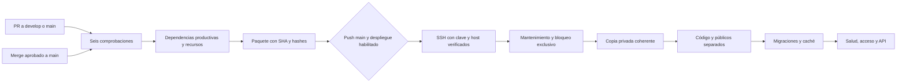

# CI/CD GitHub–Hostinger

Tarea 46, en preparación. **Código y ensayos locales preparados; conexión de GitHub, primer despliegue y recuperación reales todavía pendientes.** [Ficha y evidencias](../sdd/hostinger-cicd.md). La preparación de Hostinger (45) se cierra por aceptación expresa del usuario el 18/11/2026; sus límites se trasladan a revisión final (47), sin darlos por verificados.

Para explicar la finalidad de cada elemento en la memoria, véase [Configuración y preparación del despliegue de Aselto](configuracion-despliegue-tfm.md). Esta guía conserva las instrucciones operativas; ese capítulo desarrolla la justificación técnica y el estado de las pruebas.

## Qué automatiza

El PR a develop o main ejecuta las seis comprobaciones existentes y, si pasan, construye un paquete productivo sin secretos. Solo un **push a main después del merge protegido**, con las seis comprobaciones correctas de ese commit y la activación explícita del despliegue, puede publicar. No publica al abrir un PR ni desde develop.

El workflow reutilizable se llama desde `comprobaciones.yml` y utiliza el mismo commit que lo invoca. El job de publicación necesita el paquete de ese run, usa el entorno `production` y serializa ejecuciones sin cancelar una migración activa. Se comprueba que el SHA siga siendo main antes de transferir y antes de ejecutar la instalación. El instalador añade su propio bloqueo para impedir dos despliegues incluso fuera de GitHub.

No se han añadido los nuevos jobs a las protecciones del remoto: las seis comprobaciones obligatorias se conservan. El empaquetado se ejecuta después de ellas, pero no se convierte por sí solo en un nuevo requisito de merge. No se cambian protecciones en esta tarea.

## Destino y separación de archivos

Destino indicado por el usuario: SSH `89.116.35.1`, puerto `65002`, cuenta operativa `u842582284`, dominio `aselto.com`. La raíz está fijada y validada en el workflow: `/home/u842582284/domains/aselto.com`.

- `private/aselto`: aplicación, vendor y configuración privada existente.
- `private/incoming/COMMIT`: paquete y helpers de ese intento. No son públicos.
- `private/backups/deploy-COMMIT-FECHA-PROCESO`: copia SQL, aplicación, públicos y manifiesto de hashes.
- `public_html`: front controller adaptado y recursos públicos. Se conserva `.well-known`; no se toca la metadata `.git` si existe.

**No usar simultáneamente el despliegue Git nativo de hPanel hacia public_html.** Ese flujo no construye este paquete ni separa código privado y público. Durante la preparación el usuario guardó esa conexión y el listado posterior mostró public_html vacío salvo .git; no se conoce la operación concreta que retiró sus archivos. Se recuperaron los públicos desde la aplicación privada/paquete verificado y .htaccess de la copia. Después, HTTP confirmó portada/acceso/salud 200, API anónima 401, .git/HEAD 403 y módulo .mjs con application/javascript. Mantener la integración nativa sin despliegue automático.

## 1. Prerrequisitos del servidor

Ya confirmados por salida del usuario: PHP CLI 8.4 en su ruta absoluta, proc_open disponible y rsync, flock, tar, curl y mariadb-dump en /usr/bin. Composer y extensiones productivas se probaron durante la instalación; zip es necesario también para validar el paquete.

La instalación debe estar sana, con `.env.local` propio, JWT y var persistentes. Web, cron y SSH deben operar sobre los mismos archivos y bloqueos con el propietario correcto. No ejecutar tareas manuales de escritura en paralelo al despliegue. La función de bloqueo no cubre procesos externos que no cooperen.

Comprobar en hPanel cuota/inodos y espacio para paquete, extracción y copias; `df` de un servidor compartido no acredita cuota de la cuenta. No se automatiza todavía la eliminación de copias ni de incoming. Establecer una retención y revisar espacio antes de habilitar uso continuado. La copia externa sigue aplazada y una copia en la misma cuenta no cubre pérdida de la cuenta.

Decisión posterior sobre OPcache: el proveedor confirma PHP web 8.4.27 y OPcache activo, pero no expone ni confirma validate_timestamps/revalidate_freq ni un reinicio del pool. El usuario decide mantener este instalador y asumir operativamente que **borrar la caché del sitio desde hPanel** renueva también OPcache. Es una suposición aceptada, no una invalidación comprobada. No se adapta a releases separadas. El operador realizará esa acción manual tras publicar y comprobará el comportamiento esperado del código nuevo; un 200 de salud no demuestra por sí solo su versión. `cache:clear` de Symfony sigue sin equivaler a vaciar OPcache web. El workflow no ejecuta la acción de hPanel ni añade endpoints de invalidación. [Decisión y límites](../sdd/hostinger-opcache-assumption.md).

## 2. Preparar el bloqueo en la instalación actual

Antes del primer despliegue, instalar únicamente `DeploymentLock.php` y `Http/DeploymentGuard.php` del paquete de preparación, en sus rutas de src/Shared/Infrastructure, y reconstruir caché prod. No sobrescribir configuración, datos ni claves. Se suministra ZIP con ambos archivos y manifiesto para comprobarlos.

En prod, cada petición principal toma un bloqueo compartido en `var/share/deployment.lock`, mantenido hasta el final de la petición. Los cron `app:security` toman el mismo bloqueo. Un marcador `var/share/deployment.maintenance` hace responder 503 a peticiones nuevas y omitir el cron con `maintenance`. Los comandos de caché/migración no quedan bloqueados por este guard. Desarrollo conserva su comportamiento habitual.

Prueba guiada: crear brevemente el marcador, comprobar `/salud` con respuesta 503 y cabecera `X-Aselto-Maintenance: 1`, retirarlo y comprobar 200. Usar un bloque que retire su propio marcador al terminar; no retirar un mantenimiento de otro operador. Después comprobar el cron normal. No habilitar el CD hasta verificar esta preparación.

El instalador verifica esa cabecera antes de tocar código: un guard ausente o una caché antigua detienen el proceso y retiran únicamente el marcador creado por ese intento. Luego toma el bloqueo exclusivo, esperando hasta 120 segundos a las peticiones anteriores; si no termina la espera, aborta conservando la versión anterior. No se fuerza el cierre de peticiones.

## 3. Clave dedicada y servidor verificado

Crear una clave Ed25519 exclusiva para esta automatización, con `ssh-keygen -t ed25519`, usando un nombre específico y evitando sobrescribir claves existentes. La clave privada se guarda solo en el secreto de GitHub y bajo control del operador; no se comparte en chat ni se sube al repositorio. La pública se autoriza en Hostinger para esta cuenta. Conservar el acceso SSH habitual para recuperación y probar la clave nueva por separado.

Cuando Hostinger admita opciones en authorized_keys, limitar la clave con `restrict` (sin túneles/PTY/forwarding), comprobando que SCP/SFTP y los comandos del despliegue sigan funcionando. Esto no aísla por dominio a procesos que comparten la misma cuenta Unix: el alcance de esa cuenta y el acceso desde GitHub deben asumirse explícitamente. No se ha instalado ninguna clave desde el asistente.

Obtener la clave pública del servidor y contrastar su huella con una fuente fiable del hosting o una sesión ya verificada. `ssh-keyscan -p 65002 89.116.35.1` sirve para recogerla, **no para autenticarla por sí solo**. Si la huella no puede contrastarse, pedirla al proveedor antes de guardarla. La entrada known_hosts debe identificar `[89.116.35.1]:65002`. El workflow usa StrictHostKeyChecking=yes; no desactivar esa comprobación ni confiar ciegamente en el escaneo de la misma conexión.

## 4. Configuración en GitHub

En Settings → Environments, crear `production` y limitar sus ramas de publicación a **main**. Es un requisito antes de añadir la clave: develop y los PR no deben poder leer los secretos del entorno. El repositorio es público según la consulta realizada; comprobar las opciones que muestra la cuenta. No modificar las protecciones existentes de main/develop. Si se añaden revisores obligatorios al entorno, cada publicación esperará también esa aprobación; no se ha activado esa condición.

En el entorno production, crear:

- Variable `HOSTINGER_SSH_HOST`: `89.116.35.1`.
- Variable `HOSTINGER_SSH_PORT`: `65002`.
- Variable `HOSTINGER_SSH_USER`: `u842582284`.
- Secreto `HOSTINGER_SSH_PRIVATE_KEY`: clave privada dedicada, completa y con saltos de línea.
- Secreto `HOSTINGER_SSH_KNOWN_HOSTS`: entrada del servidor contrastada.

En las variables del **repositorio**, crear `HOSTINGER_DEPLOY_ENABLED` inicialmente como `false`. Cambiarla a `true` tras revisar bloqueo, permisos, clave, huella, cuota/retención y la decisión operativa sobre OPcache anterior. La variable no es una credencial. Su activación requiere una decisión expresa para la primera publicación; aceptar la suposición sobre caché no activa el despliegue.

El workflow pasa secretos al reutilizable, pero solo el job de despliegue accede al entorno production. Las credenciales de base, SMTP, IA y JWT **permanecen en Hostinger**; no se requieren en GitHub. El job de empaquetado utiliza valores sintéticos y no incluye caché ni configuración privada.

## 5. Qué hace la publicación

1. Instala Composer sin dependencias de desarrollo y sin scripts automáticos; comprueba plataforma. Compila Importmap, Sass y AssetMapper en prod con configuración sintética.
2. Construye un ZIP con app/web, SHA y hashes por archivo. Excluye var, JWT privados, .env.local, claves de descifrado, herramientas de prueba del proyecto y metadata Git. Incluye dependencias productivas y recursos compilados. La dependencia lcobucci/jwt se conserva; no confundir ese paquete con la carpeta privada config/jwt.
3. Publica el artefacto del run durante 14 días. En main habilitado, lo descarga del mismo run, comprueba hash y última referencia main y lo transfiere por SCP a incoming con la clave/host verificados.
4. Valida raíz, herramientas, configuración existente y entradas del ZIP; rechaza traversal, symlinks, archivos privados no permitidos, SHA/hash incorrectos y destino ya extraído. Usa un bloqueo del proceso y no sobrescribe un incoming ya usado.
5. Activa el marcador, comprueba el guard y espera al bloqueo exclusivo. Conserva el .htaccess previo y activa también mantenimiento en el servidor web.
6. Obtiene la conexión local de la aplicación para un archivo temporal de cliente SQL, modo 0600, sin imprimir contraseña ni pasarla como argumento. Genera dump transaccional, copias de aplicación/públicos y hashes; retira el archivo temporal. Los backups contienen por diseño configuración y claves, solo en la zona privada.
7. Actualiza exclusivamente directorios de código y recursos. Preserva `.env.local`, `config/jwt`, `config/secrets`, `var` y el almacenamiento. Reemplaza archivos obsoletos solo dentro de las rutas de código previstas, sin borrar todo el dominio.
8. Reconstruye caché, ejecuta migraciones no interactivas, valida esquema y reconstruye caché otra vez. Registra SHA/manifiesto en `var/share/deployed-release.json` y consulta versión de producto.
9. Coloca .htaccess con **0644**, retira mantenimiento/libera el bloqueo y consulta salud JSON, acceso 200 y API anónima 401. El SHA verificado y la carpeta de copia aparecen en el log del job.

Es una publicación con pausa, no atómica entre aplicación y públicos. Tras abrir servicio existe una ventana antes de completar los checks HTTP; si fallan, se reactiva mantenimiento. Las comprobaciones automáticas de salud no sustituyen los recorridos por rol ni una verificación funcional de todas las novedades.

## 6. Primer run y repetición

Integrar primero el PR de esta tarea en develop y comprobar CI/paquete. La futura promoción a main requiere el PR protegido y el procedimiento de versión; este trabajo conserva 1.0.0-dev y no crea etiquetas. Configurar el entorno y activar la variable antes de la publicación acordada. No abrir un PR a main ni desplegar a producción solo para probar el workflow sin revisar sus cambios y migraciones.

En Actions, revisar las seis comprobaciones, el job de paquete y el job de publicación. Verificar SHA de main, salud/acceso, visor, acceso autorizado y metadatos privados del release. Guardar log con fecha sin credenciales como evidencia del TFM. Una rama develop o un PR deben construir paquete pero omitir el job de producción.

Un incoming existente detiene una repetición del mismo SHA. No borrarlo a ciegas ni volver a ejecutar una migración fallida: revisar el estado, conservar evidencias y decidir si preparar un nuevo commit o un intento limpio tras recuperación. Las carpetas previas no se reciclan automáticamente.

## 7. Si falla

- Antes de cambiar código/esquema: se retira el marcador propio, se repone .htaccess si procede con 0644 y se conserva la instalación anterior.
- Después de comenzar la sustitución: se conserva/reactiva mantenimiento y se informa de la copia. No hay rollback SQL ni doctrine down automático. Una migración con DDL puede haber confirmado cambios parciales.
- Revisar el punto de fallo y las escrituras ocurridas antes de cerrar servicio; elegir corrección hacia delante o recuperación coherente. Restaurar solo código no restaura datos. Si hubo escrituras posteriores a la copia, evaluar su recuperación antes de reemplazar la base.
- La copia application.tar.gz contiene el marcador de mantenimiento y la pública puede contener el .htaccess de pausa: para reabrir, recuperar expresamente `public.htaccess` con permiso 0644 y retirar el marcador solo después de validar la restauración. No publicar directamente una copia sin revisar esos estados.
- Verificar hashes y restaurar primero en base/carpeta aisladas. No importar el dump sobre la base original como simple prueba.
- Si el proceso muere por una interrupción que no ejecuta los traps, comprobar mantenimiento, bloqueos y archivo temporal database-client.cnf con acceso privado. No imprimir ese archivo. Los traps no garantizan recuperación frente a SIGKILL o pérdida del servidor.

## 8. Ensayos y límites reales

Configuración real preparada por el usuario y comprobada por metadatos de GitHub: entorno production limitado únicamente a la rama main, tres variables SSH y nombres de los dos secretos existentes. Clave dedicada probada desde su ordenador con ASELTO_SSH_OK; no se ha conectado desde Actions ni leído secretos. El interruptor del repositorio HOSTINGER_DEPLOY_ENABLED está en false. La existencia del secreto no acredita aún su valor ni la conexión efectiva desde el runner.

Preparación real del guard en Hostinger confirmada: instalación/hash/caché y salud 200; marcador temporal produce 503 con X-Aselto-Maintenance: 1 el 18/11/2026 a las 18:53:04 GMT y, al retirarlo, salud vuelve a 200. No equivale todavía a comprobar el primer despliegue ni drenaje con peticiones largas.

Pruebas locales: 461 tests/1330 aserciones, PHPStan, ocho comprobaciones de archivo (válido, hash/SHA incorrectos, traversal, configuración privada y symlink) y actionlint 1.7.12. Paquete productivo sintético construido y extraído con manifiesto; la instalación local usa PHP 8.5.12, no la combinación real completa de Hostinger PHP 8.4.

En un dominio ficticio dentro de Docker, con MariaDB 11.8.9 efímera y proxy HTTPS con certificado de prueba verificado, el instalador completó copia, actualización, migraciones ya aplicadas, esquema, caché y salud. Configuración, dos claves JWT y archivo canario conservaron sus hashes; el usuario sintético siguió presente; .htaccess quedó en 0644 y no quedó el cliente SQL temporal. Un paquete de prueba con YAML inválido provocó fallo tras comenzar actualización: se conservaron marcador/.htaccess de mantenimiento y backup; se corrigió explícitamente desde la versión anterior y la salud volvió a OK. No se probaron migraciones con DDL parcialmente confirmado ni una pérdida real del servidor. El proxy de pruebas no interpreta .htaccess de LiteSpeed; esa parte se verificará en el primer despliegue real.

El bloqueo tiene pruebas de petición activa, exclusión de despliegue, mantenimiento y cron, desarrollo y comandos de migración. Todavía faltan instalar/verificar el guard real, configurar GitHub/clave/huella y ensayar el primer despliegue y su recuperación en Hostinger. No marcar tarea 46 completa hasta recibir y revisar esas evidencias.

## Para explicar en el TFM

> La instalación manual permitió verificar el procedimiento. El CI/CD lo convierte en un proceso repetible: comprueba el código, construye una versión identificable y publica solo el commit aprobado de main. GitHub no almacena los secretos fiscales ni las credenciales de la aplicación. Antes de cambiar archivos, la web entra en mantenimiento, termina las peticiones activas y se crea una copia privada. Las migraciones se ejecutan de forma controlada y el servicio se comprueba después. Si el fallo ocurre después de cambios, la recuperación requiere una decisión operativa; no prometo una reversión automática que pudiera perder datos.

Referencias oficiales consultadas el 18/11/2026: [workflows reutilizables](https://docs.github.com/en/actions/how-tos/reuse-automations/reuse-workflows), [entornos de despliegue](https://docs.github.com/en/actions/concepts/workflows-and-actions/deployment-environments) y [control de concurrencia/despliegues](https://docs.github.com/en/actions/how-tos/deploy/configure-and-manage-deployments/control-deployments). El acceso SSH y los secretos se preparan mediante pasos humanos verificados; no se presume configurado lo que solo está documentado.
