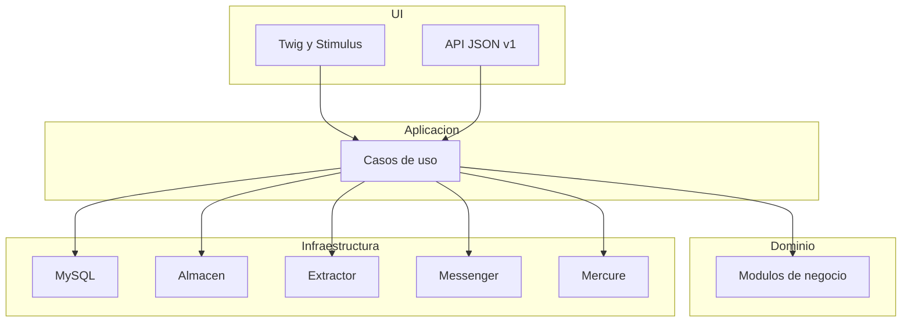

# Memoria de Aselto

Versión 0.1. Documento de partida del TFM. Vive en `docs/`, junto al resto de la documentación. El índice está en [docs/README.md](README.md). Cada tarea posterior se especifica en `docs/sdd/` antes de implementarse. Esta memoria no se reescribe para contar el trabajo del día: si una decisión cambia, se actualiza aquí y la tarea lo señala.

## 1. Producto

Aselto es una plataforma para simplificar la gestión económica y documental de autónomos y sociedades, y el trabajo con su asesoría.

El autónomo o la sociedad reúne ingresos, gastos, facturas y justificantes en un mismo sitio. La plataforma lee el documento y propone los datos. Una persona los revisa y los confirma. La asesoría consulta esa información, pide lo que falta y valida. El cliente y la asesoría ven el trimestre con cifras actualizadas.

El nombre junta asesoramiento y evolución. El eslogan es **Tus finanzas bajo control**. El dominio previsto es aselto.com. La marca oficial es el logotipo de `docs/marca/aselto-logo-eslogan-v2.png` y el icono de `docs/marca/icono.png`. No se redibuja la palabra ni la A.

Va dirigido a autónomos, sociedades y equipos de asesoría en España. La aplicación móvil queda fuera de este TFM. La API se diseña para que esa aplicación pueda usarla después.

## 2. Qué entra en el TFM

Entra una web en la que conviven varias asesorías, aisladas entre sí.

Papeles:

- Superadmin de la plataforma. Da de alta asesorías. No hay planes ni cobros.
- Admin de una asesoría. Invita gestores y da de alta clientes.
- Gestor. Revisa documentos, pide justificantes, valida y cierra el trimestre.
- Cliente. Un acceso por autónomo o por sociedad. Sube documentos y consulta su actividad.

Recorrido principal:

1. El cliente elige hacer una foto o subir un archivo.
2. Un extractor propone fecha, tercero, NIF, base, tipo de IVA, cuota, total y si es ingreso o gasto.
3. El cliente corrige, guarda un borrador o confirma el envío. La IA no confirma sola.
4. El gestor valida, corrige, rechaza o pide otro documento.
5. Solo lo validado entra en el trimestre.
6. Cliente y gestor ven las cifras. El gestor puede cerrar el trimestre y dejarlas congeladas.

Cifras, iguales para autónomo y sociedad, calculadas solo con movimientos validados:

- Ingresos: suma de bases de ingresos.
- Gastos: suma de bases de gastos.
- IVA repercutido e IVA soportado.
- Resultado: ingresos menos gastos.
- IVA del periodo: repercutido menos soportado.

Estados de un documento: `subido`, `extrayendo`, `borrador`, `validado`, `rechazado`.

Queda fuera: la app, los modelos oficiales de Hacienda, la presentación de impuestos, los bancos, el plan contable, la facturación de la propia plataforma y la emisión de facturas.

## 3. Stack

| Capa | Elección |
| --- | --- |
| Lenguaje | PHP 8.4 o superior. En esta máquina y en Docker, PHP 8.5. |
| Framework | Symfony 7.4 |
| Base de datos | MySQL 8.4 |
| Persistencia | Doctrine ORM y migraciones |
| Web | Twig, Stimulus, Turbo y AssetMapper |
| Estilos | Hoja propia con la paleta de esta memoria. Tailwind queda disponible en el proyecto y no es obligatorio para maquetar. |
| Tiempo real | Mercure, cuando el trimestre en vivo se implemente |
| Trabajos en segundo plano | Symfony Messenger con transporte Doctrine |
| API | JSON en `/api/v1`, misma lógica que la web, autenticación JWT |
| Web | Sesión de Symfony |
| Ficheros | Disco local en `var/storage`, detrás de un puerto sustituible |
| Lectura de documentos | Puerto `ExtractorDocumentos`. Adaptador de visión si hay clave. Adaptador de ejemplo si no la hay. |

La web y la API llaman a los mismos casos de uso. La app futura solo tendrá que consumir la API.

## 4. Herramientas

- Git y GitHub. Repositorio: <https://github.com/DaniCorreaPlaceres/TFM-Aselto>.
- Docker Desktop para el entorno local.
- Composer.
- `gh` para el remoto y las reglas de rama.
- OpenAI, solo como adaptador opcional de extracción. Sin clave, el flujo se enseña con el adaptador de ejemplo.
- PHPUnit, cuando una tarea incluya pruebas.
- Node, cuando haga falta construir estilos.

Método: especificación corta antes de cada tarea. La ficha vive en `docs/sdd/<tarea>.md` y contiene objetivo, fuera de alcance y criterios de aceptación. La rama de esa tarea sale de `develop`. Al terminar se anota solo lo que se ha comprobado.

## 5. Arquitectura

Monolito modular. El dominio no conoce Doctrine, HTTP ni el proveedor de IA.



Cada módulo tiene cuatro carpetas: `Domain`, `Application`, `Infrastructure` y `Ui`.

- `Shared`. Reloj, identificadores, dinero, errores de dominio y puertos que usan varios módulos.
- `Identidad`. Usuario, papel y acceso.
- `Asesoria`. Asesoría y su equipo. Toda consulta de negocio lleva la asesoría del usuario.
- `Cliente`. Ficha de autónomo o sociedad y gestor asignado.
- `Documento`. Fichero, extracción y estados.
- `Finanzas`. Movimiento validado, consulta del trimestre y cierre.
- `Comunicacion`. Solicitudes y mensajes entre cliente y asesoría.

Orden de construcción acordado:

0. Esta memoria.
1. GitHub, ramas y Docker.
2. Estructura Symfony.
3. A partir de aquí, la plataforma, tarea a tarea. El primer recorrido presentable es el de los bocetos: inicio del cliente, alta de documento, revisión humana y bandeja de la asesoría.

## 6. Especificaciones de producto

### Identidad visual

Profesional y cercano, con mucho espacio. Una acción principal por pantalla. Comprensible para alguien con poca experiencia digital.

Paleta:

- Fondo `#F7F9FA`
- Superficie `#FFFFFF`
- Texto `#14243B`
- Texto secundario `#475569`
- Acción `#006B70` con texto blanco
- Selección `#E3F1F1`
- Borde de control `#64748B`
- Error `#B42318`
- Aviso `#854D0E`
- Confirmación `#166534`

Los gastos no se pintan como errores. No hay degradados decorativos.

Tipografía sans serif, cuerpo 18 px, texto auxiliar 16 px, títulos 24–32 px, interlineado cerca de 1,5. Importes en formato español: `1.250,00 €`. Controles de al menos 48 px en móvil, con etiqueta visible.

Menú del cliente, en este orden: Inicio, Ingresos y gastos, Documentos, Mi asesoría, Ayuda. En el alta de un documento los pasos son añadir, revisar y confirmar. Los verbos son «Añadir documento», «Hacer una foto», «Subir archivo», «Guardar borrador» y «Confirmar registro».

No se dice «Todo claro» ni «Todo al día» si hay algo pendiente. La IA propone datos y no promete deducibilidad ni validez fiscal. La confianza no se inventa como un porcentaje.

El inicio muestra el saludo, la acción de añadir un documento, los ingresos y gastos del periodo y lo que está pendiente de revisión.

### Reglas de negocio ya cerradas

- Un cliente pertenece a una asesoría. Un gestor solo ve clientes de la suya.
- El cliente puede corregir el borrador. El gestor puede corregirlo al validar.
- Si el trimestre de esa fecha está cerrado, no se valida otro movimiento dentro de él.
- La foto en el móvil usa la cámara del dispositivo. En escritorio, el mismo paso admite un archivo.
- Tipos de IVA previstos: 0, 4, 10 y 21. La cuota se calcula desde la base y el tipo cuando la persona confirma.
- Archivos admitidos: PDF, JPEG, PNG y WebP.

### API prevista

Prefijo `/api/v1`. La sesión web no sustituye a esta API. El contrato concreto se escribe en la tarea que lo abra. La primera comprobación de entorno es `GET /salud`, que no forma parte del producto.

## 7. Ramas y entorno

`main` está protegida. No se trabaja sobre ella ni se le hace push directo. Recibe una versión cuando se promueve desde `develop` mediante pull request.

`develop` es la rama de integración. Cada tarea crea una subrama `feature/<tarea>` desde `develop` y vuelve a `develop` mediante pull request.

Entorno local:

```bash
docker compose up --build
```

La web queda en <http://localhost:8080>. MySQL publica el puerto 3306, con base `aselto`, usuario `aselto` y contraseña `aselto`. Mercure publica el puerto 9080. Esas credenciales son solo de desarrollo.

Dentro de los contenedores la base se llama `database`. Desde la máquina anfitriona, `127.0.0.1`.

Comprobación:

```bash
curl http://localhost:8080/salud
```

La respuesta esperada es estado `ok` y base de datos `ok`.

## 8. Documentación

Todo el material escrito del proyecto está en `docs/`:

- `memoria.md`, este documento.
- `producto/`, la introducción.
- `diseno/`, las reglas visuales y los bocetos.
- `marca/`, el logotipo y el icono oficiales.
- `sdd/`, la ficha de cada tarea antes de programarla.

## 9. Estructura de código prevista

```text
src/
  Shared/
  Identidad/
  Asesoria/
  Cliente/
  Documento/
  Finanzas/
  Comunicacion/
templates/
assets/
docker/
```

Cada módulo reservará `Domain`, `Application`, `Infrastructure` y `Ui`. Esas carpetas son el punto 2 y todavía no están creadas. La plataforma no tiene pantallas, casos de uso ni tablas de negocio.
