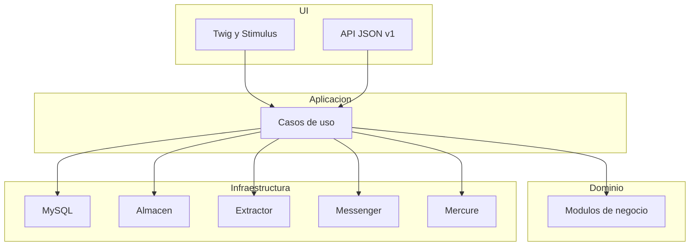

# Memoria de Aselto

Versión 0.1. Documento de partida del TFM. Vive en `docs/`, junto al resto de la documentación. El índice está en [docs/README.md](README.md). Cada tarea posterior se especifica en `docs/sdd/` antes de implementarse. Esta memoria no se reescribe para contar el trabajo del día: si una decisión cambia, se actualiza aquí y la tarea lo señala.

## 1. Producto

Aselto es una plataforma para simplificar la gestión económica y documental de autónomos y sociedades, y el trabajo con su asesoría.

El autónomo o la sociedad reúne ingresos, gastos, facturas y justificantes en un mismo sitio. La plataforma lee el documento y propone los datos. Una persona los revisa y los confirma. La asesoría consulta esa información, pide lo que falta y valida. El cliente y la asesoría ven el trimestre con cifras actualizadas.

El nombre junta asesoramiento y evolución. El eslogan es **Tus finanzas bajo control**. El dominio previsto es aselto.com. La marca oficial es el logotipo de `docs/marca/aselto-logo-eslogan-v2.png` y el icono de `docs/marca/icono.png`. No se redibuja la palabra ni la A.

Va dirigido a autónomos, sociedades y equipos de asesoría en España. La aplicación móvil queda fuera de este TFM. La API se diseña para que esa aplicación pueda usarla después.

## 2. Qué entra en el TFM

Entra una web en la que conviven varias asesorías, aisladas entre sí.

Papeles:

- Superadmin de la plataforma. Da de alta asesorías y también un cliente sin asesoría. No hay planes ni cobros.
- Admin de una asesoría. Invita gestores, da de alta clientes y también revisa sus registros.
- Gestor. Revisa documentos, pide justificantes, valida y cierra el trimestre.
- Cliente. Un acceso por autónomo o por sociedad. Puede usar la plataforma solo o vinculado a una asesoría. Sube documentos y consulta su actividad.

Recorrido principal:

1. El cliente elige hacer una foto o subir un archivo.
2. Un extractor propone fecha, tercero, NIF, base, impuesto y su tipo, y si es ingreso o gasto. La cuota y el total se calculan.
3. El cliente corrige, guarda un borrador o confirma el envío. La IA no confirma sola.
4. El admin o el gestor de la asesoría valida, corrige, rechaza con motivo o pide un justificante adicional.
5. Con asesoría, solo lo validado entra en las cifras validadas del trimestre. Sin asesoría, los documentos confirmados cuentan en las cifras personales, diferenciadas de una validación de asesoría.
6. Cliente y gestor ven las cifras según su acceso. El gestor puede cerrar el trimestre de la asesoría y dejarlas congeladas. El cliente sin asesoría puede cerrar su trimestre para su control personal.

Cifras, iguales para autónomo y sociedad, calculadas con movimientos validados cuando hay asesoría y con documentos confirmados para el control personal cuando no la hay:

- Ingresos: suma de bases de ingresos.
- Gastos: suma de bases de gastos.
- IVA repercutido e IVA soportado.
- Resultado: ingresos menos gastos.
- IVA del periodo: repercutido menos soportado.

Estados de un documento: `subido`, `extrayendo`, `borrador`, `enviado`, `validado`, `rechazado`. El cliente confirma y el documento pasa a `enviado`. La asesoría lo valida o lo rechaza después. Solo `validado` entra en las cifras validadas de la asesoría. Sin asesoría, la confirmación permite incluirlo en las cifras personales y no equivale a una validación de asesoría.

Queda fuera: la app, los modelos oficiales de Hacienda, la presentación de impuestos, los bancos, el plan contable, el cobro y la factura de la licencia de Aselto, y la emisión de facturas. La licencia existe en el producto, pero aquí se supone que el cliente puede registrarse directamente.

## 3. Stack

| Capa | Elección |
| --- | --- |
| Lenguaje | PHP 8.4 o superior. En esta máquina y en Docker, PHP 8.5. |
| Framework | Symfony 7.4 |
| Base de datos | MySQL 8.4 |
| Persistencia | Doctrine ORM y migraciones |
| Web | Twig, Stimulus, Turbo y AssetMapper |
| Estilos | Hoja propia con la paleta de esta memoria. Tailwind queda disponible en el proyecto y no es obligatorio para maquetar. |
| Tiempo real | Mercure, cuando el trimestre en vivo se implemente |
| Trabajos en segundo plano | Symfony Messenger con transporte Doctrine |
| API | JSON en `/api/v1`, misma lógica que la web, autenticación JWT |
| Web | Sesión de Symfony |
| Ficheros | Disco local en `var/storage`, detrás de un puerto sustituible |
| Lectura de documentos | Puerto `DocumentExtractor`. Adaptador de visión si `OPENAI_API_KEY` tiene valor. Si no la hay, un adaptador de ejemplo rellena datos de prueba y la pantalla lo dice. La cuota y el total se calculan. |

La web y la API llaman a los mismos casos de uso. La app futura solo tendrá que consumir la API.

## 4. Herramientas

- Git y GitHub. Repositorio: <https://github.com/DaniCorreaPlaceres/TFM-Aselto>.
- Docker Desktop para el entorno local.
- Composer.
- `gh` para el remoto y las reglas de rama.
- OpenAI, solo como adaptador opcional de extracción. Sin clave, el flujo se enseña con el adaptador de ejemplo.
- PHPUnit, PHPStan, PHP-CS-Fixer y la validación OpenAPI. En cada pull request hacia `develop` o `main` los ejecuta `.github/workflows/comprobaciones.yml`.
- Node, cuando haga falta construir estilos.

Método: especificación corta antes de cada tarea. La ficha vive en `docs/sdd/<tarea>.md` y contiene objetivo, fuera de alcance y criterios de aceptación. La rama de esa tarea sale de `develop`. Al terminar se anota solo lo que se ha comprobado.

## 5. Arquitectura

Monolito modular. El dominio no conoce Doctrine, HTTP ni el proveedor de IA.



Cada módulo tiene cuatro carpetas: `Domain`, `Application`, `Infrastructure` y `Ui`.

- `Shared`. Reloj, identificadores, dinero, errores de dominio y puertos que usan varios módulos.
- `Identidad`. Usuario, papel y acceso.
- `Asesoria`. Asesoría y su equipo. Una asesoría no ve datos de otra. Un cliente sin asesoría solo ve los suyos.
- `Cliente`. Ficha de autónomo o sociedad. La asesoría y el gestor son opcionales.
- `Documento`. Fichero, extracción y estados.
- `Finanzas`. Movimiento validado, consulta del trimestre y cierre.
- `Comunicacion`. Solicitudes y mensajes entre cliente y asesoría.

Orden de construcción acordado:

0. Esta memoria. Hecha.
1. GitHub, ramas y Docker. Hecho. `main` está protegida, `develop` integra, y cada pull request ejecuta las cuatro comprobaciones. El entorno local arranca y `GET /salud` responde.
2. Estructura Symfony. Hecha. Los siete módulos tienen `Domain`, `Application`, `Infrastructure` y `Ui`. El dominio no se registra como servicio.
3. A partir de aquí, la plataforma, tarea a tarea. Ya están el acceso, la home comercial, el alta de asesorías y de su equipo, el alta de clientes, el inicio del cliente, el alta de un documento, su lectura y el perfil fiscal editable. Los documentos ya usan el impuesto del territorio del cliente. Los gastos con IVA ya admiten recargo de equivalencia. Los ingresos de autónomos ya admiten retención de IRPF opcional. La bandeja ya permite a admin y gestor revisar, validar, rechazar y pedir justificantes. El trimestre ya muestra cifras, cierre, reapertura e histórico. Lo siguiente son los mensajes y solicitudes entre cliente y asesoría.

## 6. Especificaciones de producto

### Identidad visual

Profesional y cercano, con mucho espacio. Una acción principal por pantalla. Comprensible para alguien con poca experiencia digital.

Paleta:

- Fondo `#F7F9FA`
- Superficie `#FFFFFF`
- Texto `#14243B`
- Texto secundario `#475569`
- Acción `#006B70` con texto blanco
- Selección `#E3F1F1`
- Borde de control `#64748B`
- Error `#B42318`
- Aviso `#854D0E`
- Confirmación `#166534`

Los gastos no se pintan como errores. No hay degradados decorativos.

Tipografía sans serif, cuerpo 18 px, texto auxiliar 16 px, títulos 24–32 px, interlineado cerca de 1,5. Importes en formato español: `1.250,00 €`. Controles de al menos 48 px en móvil, con etiqueta visible.

Menú del cliente, en este orden: Inicio, Ingresos y gastos, Documentos, Mi asesoría, Ayuda. En el alta de un documento los pasos son añadir, revisar y confirmar. Los verbos son «Añadir documento», «Hacer una foto», «Subir archivo», «Guardar borrador» y «Confirmar registro».

No se dice «Todo claro» ni «Todo al día» si hay algo pendiente. La IA propone datos y no promete deducibilidad ni validez fiscal. La confianza no se inventa como un porcentaje.

El inicio muestra el saludo, la acción de añadir un documento, los ingresos y gastos del periodo y lo que está pendiente de revisión.

### Reglas de negocio ya cerradas

- El superadmin no pertenece a una asesoría. El admin y el gestor sí.
- Un cliente puede registrarse directamente, en principio sin asesoría. El superadmin también puede dar de alta un cliente sin asesoría.
- Quien da de alta un acceso no escribe la contraseña. La persona la crea con un enlace de su correo, de un solo uso y con caducidad.
- El admin de una asesoría da de alta a los clientes de la suya. Si un cliente está vinculado, un gestor solo ve los de esa asesoría.
- El cliente puede corregir el borrador y un registro rechazado. El admin o el gestor puede corregirlo al validar.
- El rechazo exige un motivo y permite corregir y reenviar el mismo registro. Se conservan el original, los justificantes y el historial del rechazo.
- La solicitud de justificante exige un motivo. El registro sigue enviado con solicitud pendiente y no se valida hasta que su propietario aporte un archivo adicional. Aportarlo conserva los datos fiscales y no valida automáticamente.
- Cada revisión guarda acción, autor, fecha, motivo y datos anteriores y posteriores. Los registros validados no se editan desde estas pantallas.
- La bandeja y sus descargas comprueban el papel del actor, la asesoría del registro y la vinculación actual del cliente. Solo se comparten enviados, rechazados y validados; los borradores quedan para el cliente.
- Si el trimestre de esa fecha está cerrado, no se valida otro movimiento dentro de él.
- Un cierre personal también congela sus cifras. Para incorporar una corrección que las cambie, primero se reabre el trimestre.
- Admin y gestor cierran y reabren los trimestres de su asesoría. El cliente sin asesoría gestiona sus periodos personales y conserva el permiso para reabrir sus cierres personales anteriores.
- Los pendientes con fecha del trimestre y los documentos sin fecha de ese ámbito bloquean el cierre. El periodo puede cerrarse sin actividad si no tiene pendientes. Las nuevas subidas se muestran aparte de un cierre y no cambian su copia de cifras. Para confirmar, validar o cambiar datos fechados en un periodo cerrado, primero se reabre; se comprueban fecha original y destino.
- El cliente sin asesoría puede iniciar una corrección de un registro personal confirmado en un periodo abierto. Vuelve a borrador, conserva el historial y debe confirmarlo de nuevo.
- Las cifras suman bases de ingresos y gastos; el resultado es su diferencia. IVA, IGIC e IPSI muestran cuotas de ingresos y gastos y su diferencia por separado. El recargo de gastos y la retención de ingresos se muestran aparte. No se calcula deducibilidad ni se presenta una liquidación fiscal.
- El cliente puede reabrir sus cierres personales. El admin o el gestor puede reabrir los cierres de su asesoría. Cada reapertura registra quién la realiza y cuándo.
- Una asesoría invita a vincularse a un cliente que ya tiene cuenta. Solo al aceptar el cliente se da acceso a sus documentos e histórico.
- Al vincularse, se conservan los cierres personales anteriores y se identifican como tales. La asesoría puede consultar ese histórico; no pasa a estar validado automáticamente.
- Los documentos confirmados de trimestres todavía abiertos pasan a revisión de la asesoría al aceptar la vinculación. Conservan los datos y la confirmación original. Las cifras distinguen lo pendiente de lo validado.
- La foto en el móvil usa la cámara del dispositivo. En escritorio, el mismo paso admite un archivo.
- Tipos de IVA en Península y Baleares: 0, 4, 10 y 21. La cuota se calcula desde la base y el tipo cuando ambos están escritos. El total es la base más la cuota y, si el gasto lleva recargo de equivalencia, su cuota, y resta la retención de IRPF del ingreso, si la hay; se rellena solo. La lectura propone el resto de campos y no cambia esos dos importes.
- Si no hay clave de lectura, los datos propuestos son un ejemplo. La pantalla lo dice. Si la lectura falla, la persona escribe los datos.
- Archivos admitidos: PDF, JPEG, PNG y WebP.
- El alta de un cliente y el de una asesoría piden también NIF o CIF, teléfono, dirección, código postal, municipio y provincia. El formato del NIF, el CIF o el NIE se comprueba.
- Esos datos se pueden editar en el perfil. Cada persona edita los suyos. El admin de una asesoría edita los de sus clientes. El gestor los ve y no los cambia.
- La provincia fija el territorio. Península y Baleares usan IVA. Canarias usa el IGIC, con tipos 0, 3, 7, 9,5, 15 y 20. Ceuta y Melilla usan el IPSI. El documento propone el impuesto de ese territorio.
- Para el IPSI, la persona introduce manualmente el porcentaje que figura en el documento. Aselto calcula la cuota desde la base y ese porcentaje, y el total como base más cuota, menos la retención de IRPF del ingreso si la hay. La persona revisa y confirma los datos; la plataforma no determina qué tipo de IPSI corresponde.
- Un gasto con IVA puede llevar recargo de equivalencia opcional: 5,2 % con IVA 21 %, 1,4 % con IVA 10 % y 0,5 % con IVA 4 %. Para tabaco se admite 1,75 % con IVA 21 %, identificado expresamente. La persona elige el recargo del documento; la plataforma no decide si pertenece a ese régimen. La cuota se calcula sobre la base y se suma al total. No se admite en ingresos, IGIC, IPSI ni IVA 0 %. El catálogo del TFM no incluye tipos históricos temporales.
- La lectura solo propone el recargo si figura expresamente y es compatible; no lo deduce por el tipo de IVA. El ejemplo no añade recargo.
- Un ingreso de un autónomo puede llevar retención de IRPF opcional, con IVA, IGIC o IPSI. La persona introduce el porcentaje que figura en el documento; Aselto no decide si corresponde retener ni el tipo fiscal. Se acepta entre 0 y 100 con hasta dos decimales como límite técnico, no como catálogo de tipos. La cuota se calcula sobre la base, se redondea al céntimo y se resta del total. No se admite en gastos ni en ingresos de sociedades; el servidor comprueba el tipo de cliente guardado.
- La lectura solo propone retención explícita y válida en ingresos de autónomos. No la deduce del IVA ni del perfil y no acepta cuotas o totales calculados por el proveedor. El ejemplo no añade retención.
- La plataforma, incluida la home comercial, se maqueta con Bootstrap 5. Siguen mandando la marca y las reglas visuales.
- Añadir un documento acaba en una sola zona: hacer una foto, elegir un archivo o arrastrarlo.

### API prevista

Prefijo `/api/v1`. La sesión web no sustituye a esta API. El contrato vive en `openapi/openapi.yaml`: OpenAPI 3.0.3, título «Aselto API», versión 0.1.0. Hoy declara el documento y deja las rutas vacías. Las operaciones de producto se añaden en la tarea de la API. La primera comprobación de entorno es `GET /salud`, que no forma parte del producto.

## 7. Ramas y entorno

`main` está protegida. No se trabaja sobre ella ni se le hace push directo. Recibe una versión cuando se promueve desde `develop` mediante pull request.

`develop` es la rama de integración. Cada tarea crea una subrama `feature/<tarea>` desde `develop` y vuelve a `develop` mediante pull request.

Cada pull request y cada push a `develop` o `main` ejecuta `.github/workflows/comprobaciones.yml` con PHP 8.4, la versión mínima del proyecto. Los cuatro trabajos son:

- **PHP-CS-Fixer.** Revisa el estilo en seco, con las reglas `@Symfony`. No reescribe los finales de línea.
- **PHP-Stan.** Analiza `src`, `tests` y `bin/validate-openapi.php` en el nivel 6.
- **PHPUnit.** Ejecuta la suite de `tests/`.
- **OpenAPI.** Valida `openapi/openapi.yaml` con `bin/validate-openapi.php`.

Entorno local:

```bash
docker compose up --build
```

La web queda en <http://localhost:8080>. MySQL publica el puerto 3306, con base `aselto`, usuario `aselto` y contraseña `aselto`. Mercure publica el puerto 9080. El buzón local es Mailpit, en <http://localhost:8025>. Esas credenciales son solo de desarrollo.

Dentro de los contenedores la base se llama `database`. Desde la máquina anfitriona, `127.0.0.1`.

La imagen de PHP instala `intl`, `pdo_mysql`, `zip` y `bcmath`. OPcache se activa en `docker/php/php.ini`. El script `docker/php/entrada.sh` se guarda con finales de línea Unix; `.gitattributes` lo mantiene así.

`GET /salud` no forma parte del producto. Ya está comprobado: responde 200 con `{"estado":"ok","base_de_datos":"ok"}`. MySQL 8.4 queda sano en el puerto 3306. Mercure responde en el 9080.

`/` es la home comercial y es pública. Usa el logotipo oficial y se dirige a autónomos, sociedades y asesorías. Explica que el documento se añade, los datos se revisan y el trimestre se actualiza. La única acción es Entrar, hacia `/entrar`. Si ya hay sesión, esa acción se llama Tu acceso y abre `/cuenta`. No hay precios en esta página. Quien no tiene sesión ve también «Crear acceso», hacia `/registro`.

El acceso de la web es la sesión de Symfony. `GET /entrar` pide el correo y la contraseña. Si el acceso es correcto, `/cuenta` muestra el papel del superadmin, del admin y del gestor. El cliente pasa de ahí a `/inicio`. Salir cierra la sesión. `GET /salud` sigue abierto sin entrar.

Tras migrar, `php bin/console app:seed-dev-access` crea la asesoría de prueba y cuatro accesos locales. La contraseña es `aselto-dev` y solo vale en desarrollo:

- `superadmin@example.test`, sin asesoría
- `admin@example.test` y `gestor@example.test`, en «Asesoría de prueba»
- `cliente@example.test`, sin asesoría

El superadmin abre `/asesorias` desde su acceso. Da de alta una asesoría con nombre y correo del admin. No hay planes ni cobros. El admin abre `/equipo`, ve solo el equipo de la suya e invita a un gestor con su correo. Un gestor no abre esas pantallas. Una asesoría no ve el equipo de otra. Un correo que ya existe se rechaza.

`/registro` es público. Crea un cliente, autónomo o sociedad, sin asesoría. El superadmin, en `/clientes`, da de alta otro cliente sin asesoría y ve solo esos. El admin da de alta a los de su asesoría. El gestor ve los de la suya y no puede darlos de alta. Una asesoría no ve los clientes de otra.

En todos esos altas se envía un correo. El enlace confirma la dirección y permite crear la contraseña. Caduca a las 24 horas y vale una vez. Hasta entonces no se puede entrar. Quien olvida la contraseña pide otro enlace en `/recuperar`; ese caduca a las 2 horas. Si la cuenta aún no tiene contraseña, se reenvía el enlace de alta. El mensaje es el mismo aunque el correo no exista. La contraseña de desarrollo `aselto-dev` sigue valiendo para los cuatro accesos de prueba, que ya están confirmados.

El cliente, en `/inicio`, ve el logotipo oficial y el menú: Inicio, Ingresos y gastos, Documentos, Mi asesoría y Ayuda. El saludo usa su nombre y la única acción principal es «Añadir documento». El resumen del trimestre muestra ingresos y gastos por sus bases, distinguiendo el control personal de los registros validados por la asesoría. En Ingresos y gastos se eligen año y trimestre, se consulta el detalle y se cierran o reabren los periodos según los permisos. Los gastos no van en rojo. Si tiene asesoría, Mi asesoría muestra el nombre de la suya. Si no tiene, lo dice. Un admin o un gestor no abre ese inicio.

«Añadir documento» deja elegir «Hacer una foto» o «Subir archivo». Al subirlo, el extractor propone los datos y el cliente los revisa junto al archivo. Puede corregirlos, guardar un borrador o confirmar. Si no hay clave, los datos son un ejemplo y la pantalla lo dice. Si la lectura falla, el documento queda subido y la persona escribe los datos. El total se calcula solo. Confirmar deja el registro enviado: no lo valida la asesoría y no cambia las cifras. Lo recién subido o en borrador aparece en el inicio como pendiente de su revisión. Solo ve sus documentos. Si tiene asesoría, el documento queda ligado a esa. Un archivo admitido ocupa menos de 8 MB y se guarda en `var/storage`.

Los registros validados alimentan las cifras del trimestre de la asesoría. La petición de justificante conserva el estado enviado y lo muestra como «Justificante pendiente». Las rutas de archivos comprueban los mismos permisos que la ficha.

## 8. Documentación

Todo el material escrito del proyecto está en `docs/`:

- `memoria.md`, este documento.
- `producto/`, la introducción.
- `diseno/`, las reglas visuales y los bocetos.
- `marca/`, el logotipo y el icono oficiales.
- `sdd/`, la ficha de cada tarea antes de programarla.

## 9. Estructura de código prevista

```text
src/
  Shared/
  Identidad/
  Asesoria/
  Cliente/
  Documento/
  Finanzas/
  Comunicacion/
templates/
assets/
docker/
```

`GET /salud` vive en `src/Controller/HealthController.php`. Cada módulo tiene `Domain`, `Application`, `Infrastructure` y `Ui`. El dominio no se registra como servicio.

La home comercial vive en `src/Controller/CommercialHomeController.php`. Identidad ya tiene el usuario, el papel, el acceso y los enlaces de correo. Las tablas son `identity_user` y `access_token`. Asesoría ya da de alta la asesoría y permite invitar a su gestor. La tabla es `advisory_firm`. Cliente ya registra autónomos y sociedades, y el cliente entra por `/inicio`. La tabla es `client_profile`. Documento ya guarda el archivo y, al subirlo, propone los datos. La tabla es `client_document`. La clave de lectura, si se usa, va en `.env.local` y no en el repositorio. El cliente edita sus datos en `/perfil`. El admin edita los de la asesoría en `/asesoria/datos` y los de un cliente de la suya desde la lista. El gestor los consulta y no los cambia. Los documentos nuevos guardan IVA, IGIC o IPSI según la provincia del cliente al subirlos. Los anteriores conservan IVA. Cambiar la provincia no cambia el impuesto de un documento ya guardado. Si falta la provincia, se pide completar el perfil antes de guardar el archivo. Los gastos con IVA guardan el recargo de equivalencia opcional y su cuota por separado, y lo incluyen en el total. Los documentos anteriores permanecen sin recargo. Los ingresos de autónomos guardan el porcentaje y la cuota de retención de IRPF opcional y la descuentan del total. Los documentos anteriores permanecen sin retención. La bandeja está en `/bandeja`: admin y gestor de la misma asesoría revisan los registros enviados, pueden corregir al validar, rechazar con motivo o pedir un justificante adicional. El cliente corrige y reenvía los rechazados o aporta el justificante desde su registro. El historial y los archivos adicionales se guardan en el mismo agregado, con versiones para evitar sobrescrituras. Finanzas consulta los registros por fecha fiscal y guarda cierres y reaperturas en `financial_quarter`, separados por cliente, asesoría o control personal, año y trimestre. Cada cierre conserva sus registros e importes; las reaperturas conservan la versión anterior y el autor y momento de la acción. Las operaciones que cambian documentos y los cierres se coordinan por cliente mediante una transacción.
